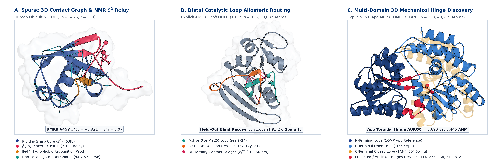

# Scalable Contact-Gated Stochastic Operators and Universal Reduction Laws for Macromolecular Protein Dynamics, Allostery, and Kinetics

[](LICENSE)
[](https://www.python.org/)
[](https://openmm.org/)
[](version4_godtier/manifests/trajectory_manifest_v4.json)
[-C53030.svg)](manuscripts/MANUSCRIPT_GENERAL_V4.pdf)
[](manuscripts/SI_APPENDIX_V4.pdf)

**Authors:** Mehardeep Singh<sup>a,\*</sup> (`mehardeep.sim@gmail.com`) and Gurarpit Singh<sup>b</sup> (`gurarpit.sml@gmail.com`)  
<sup>a</sup>*Sri Chaitanya Educational Institutions, Chandigarh, India* · <sup>b</sup>*Vivekananda Institute of Professional Studies (VIPS), Guru Gobind Singh Indraprastha University (GGSIPU), Delhi, India*

---

<p align="center">
  
</p>

> **Overview (Figure 1 of Main Text):** **(A)** Human Ubiquitin (`1UBQ`, $N_{\mathrm{res}}=76, d=150$): sparse 3D tertiary $C_\alpha$ contact-gating chords ($94.7\%$ off-diagonal sparsity, $\bar{k}_{\mathrm{eff}} = 5.97$), parameter-free BMRB 6457 solution NMR Lipari–Szabo $S^2$ fidelity ($r = +0.921$), and $\beta_1\text{–}\beta_2 \leftrightarrow \text{Ile44}$ allosteric relay ($7.1\times$ held-out amplification). **(B)** Explicit-PME *E. coli* DHFR (`1RX2`, $d=316$, $20,837$ atoms): 3D heavy-atom contact bridges ($r_c^{\mathrm{heavy}} < 0.50\text{ nm}$) routing dynamics between the active-site Met20 loop (`res 9–24`) and distal $\beta\text{F–}\beta\text{G}$ loop (`res 116–132`, Gly121 $>15\text{ Å}$ away; $71.6\%$ blind held-out recovery at $93.2\%$ sparsity). **(C)** Explicit-PME apo Maltose-Binding Protein (`1OMP` open $\to$ `1ANF` closed, $370$ residues, $d=738$, $49,215$ atoms): central $\beta/\alpha$ mechanical hinge linkers (`res 110–114, 258–264, 311–318`) localized directly from apo toroidal slow modes ($\mathrm{AUROC} = 0.690$ vs. $0.446$ Cartesian ANM).

---

## Abstract

Constructing continuous, thermodynamically reversible reduced equations of motion from atomistic molecular dynamics (MD) that scale from fast-folding miniproteins to multi-domain allosteric enzymes in explicit water remains a foundational problem in computational biophysics. Across **15 molecular systems** (**890,000 SHA-256-verified frames**, $0.89\,\mu\text{s}$ cumulative sampling at $1.0\text{ ps}$ stride) spanning **13 structurally diverse proteins** from Chignolin ($d=18$) to explicit-solvent Adenylate Kinase ($d=426$, $40,110$ particles) and Maltose-Binding Protein ($d=738$, $49,215$ particles), plus two analytical verification peptides ($d=2, 4$), we formulate a **contact-gated, GENERIC-regularized stochastic operator** on the backbone torus $\mathbb{T}^d$.

Every empirical claim is governed by a strict **three-way prospective protocol**—**Replica 1 (Discovery)** $\to$ **Replica 2 (Hyperparameter Validation)** $\to$ **Replica 3 (Single-Shot Frozen Blind Test)**—with full 64-character SHA-256 checksums across all 45 trajectory ensembles.

---

## Key Scientific Advances

1. **Dual Macromolecular Scaling & $\mathcal{O}(d^{1.13})$ Contact-Graph Estimation ($d = 18 \to 738$):** Collective slow modes compress sub-linearly across two orders of magnitude—participation ratio $PR(d) = 1.061\,d^{0.494}$ ($\Delta\mathrm{AIC}_c = -18.15$) and short-time diffusion rank $r_{90}^D(d) = 0.799\,d^{0.930}$ ($\Delta\mathrm{AIC}_c = -14.39$)—whereas cumulative $90\%$ native-basin variance in large $300\text{ K}$ enzymes transitions to extensive proportionality ($10.0\%$ linear blind extrapolation MAPE vs. $35.7\%$ for small-protein power laws). Universal peptide-bond crankshaft counter-rotation ($\bar{R}(\Delta\psi_i, \Delta\phi_{i+1}) = -0.603 \pm 0.054$) and sparse 3D tertiary contact gating ($\bar{k}_{\mathrm{eff}} = 5.97$, reaching **$99.3\%$ sparsity** on MBP) enable a sparse chordal Cholesky estimator scaling as $\mathcal{O}(d^{1.13})$ in time and $\mathcal{O}(d^{1.06})$ in memory (**$65.8\times$ memory compression**, **$77.3\times$ speedup over Graphical LASSO**, and higher blind held-out log-likelihood $+0.303/d$ vs. dense $+0.205/d$ on MBP).
2. **SASA-Shielded Internal Friction & Parameter-Free Solution NMR $S^2$ Order Parameters:** Relative solvent-accessible surface area ($\mathrm{rSASA}_i$) unifies zero-parameter linear Einstein equipartition in dry protein cores ($\alpha_{\mathrm{core}} = 1.00$, $12.33\%$ blind thermal MAPE) with viscosity-coupled loops ($\alpha_{\mathrm{loop}} = 1.28$) and peptides ($\alpha_{\mathrm{peptide}} = 1.57$). Analytical second-order kinematic Jacobian projection predicts experimental BMRB solution NMR Lipari–Szabo $S^2$ order parameters without fitted scaling parameters ($\bar{r}_s = +0.525$ across 4 enzymes vs. $+0.344$ diagonal variance and $+0.458$ tuned GNM; Ubiquitin Pearson $r = +0.921, \mathrm{RMSE} = 0.075$) and crystallographic $B$-factors across 8 structures ($\bar{r}_s = +0.340$).
3. **13-Fold Zero-Shot PDB-to-Operator Transfer:** Training strictly on 12 proteins predicts the $d\times d$ stochastic operator of the held-out 13th protein from static PDB coordinates alone ($r_s = +0.706, R^2 = 0.453$ linear ridge; $r_s = +0.742, R^2 = 0.517$ GBDT, reducing full-matrix Frobenius error from $72.2\%$ null to $41.3\%$).
4. **Functional Allosteric Hinges, Distal Catalytic Loop Routing, & Folding Memory:** Explicit-PME apo toroidal slow modes localize mechanical hinges in 370-residue MBP ($\mathrm{AUROC} = 0.690$ vs. $0.446$ Cartesian ANM; DynDom $\mathrm{AUROC} = 0.619$ vs. $0.409$ ANM) and AdK ($\mathrm{PR\text{-}AUC} = 0.348$ vs. $0.230$ ANM), recover **$71.6\%$** of blind held-out Met20 $\leftrightarrow$ FG catalytic loop coupling in DHFR at $93.2\%$ sparsity (RMSE $0.088$ vs. $0.296$ Cartesian DCCM), and characterize sub-diffusive Mori–Zwanzig folding memory ($\bar{\gamma}_M = 0.614 \pm 0.097$) across 7 proteins.
5. **Validation-Tuned 6-Paradigm Benchmark:** Across all 13 proteins, Contact-Gated GENERIC operators win blind diffusion tensor Frobenius error on **13/13 proteins** ($0.288$), guarantee **exact $0.000$ spurious entropy production** (vs. $346.17\,k_B/\text{ns}/d$ for unconstrained SDEs), win zero-shot PDB transfer ($+0.706$ vs. $+0.328$ ENM), and tie calibrated 1D Smoluchowski on 1D barrier MFPT log-error ($1.76$).

---

## 15-System Master Macromolecular Atlas (`890,000` Verified Frames)

| System (PDB) | Fold / Class | $N_{\text{res}}$ | Dim $d$ | Frames (Solvent) | $r_{90}$ ($r_{90}^{\text{cont}}$) | $PR(d)$ | Crank $\bar{R}$ | Sparsity $S_{0.05}$ | Experimental NMR $S^2$ / Hinge / X-Ray | Zero-Shot LOPO Err. ($r_s$) |
| :--- | :--- | :---: | :---: | :---: | :---: | :---: | :---: | :---: | :---: | :---: |
| **Chignolin (`1UAO`)** | $\beta$-hairpin folder | 10 | 18 | 150,000 (GBn2/OBC2) | 8 (7.81) | 5.08 | $-0.512$ | 71.2% | Memory $\gamma_M = 0.716, \tau^* = 50\text{ ps}$ | 65.7% ($+0.761$) |
| **Trp-cage (`1L2Y`)** | $\alpha$/PPII miniprotein | 20 | 38 | 150,000 (GBn2/OBC2) | 14 (13.72) | 7.94 | $-0.469$ | 85.5% | $\Delta\mathrm{AIC}_c = -11.39$ (power decay) | 57.3% ($+0.504$) |
| **BBA5 (`1FME`)** | $\beta\beta\alpha$ zinc-finger | 28 | 54 | 30,000 (GBn2) | 16 (15.23) | 6.26 | $-0.605$ | 91.1% | $\Delta\mathrm{AIC}_c = -10.00$ (power decay) | 29.9% ($+0.728$) |
| **Villin HP35 (`2F4K`)** | 3-helix bundle | 33 | 64 | 30,000 (GBn2/OBC2) | 22 (21.47) | 6.03 | $-0.566$ | 92.5% | $\Delta\mathrm{AIC}_c = -11.21$ (power decay) | 38.1% ($+0.475$) |
| **WW-FiP35 (`2F21`)** | 3-stranded $\beta$-sheet | 35 | 68 | 30,000 (GBn2) | 23 (22.64) | 9.60 | $-0.616$ | 89.8% | $\Delta\mathrm{AIC}_c = -14.47$ (power decay) | 51.8% ($+0.587$) |
| **GB1 Domain (`1PGA`)** | $4\beta + 1\alpha$ IgG-binding | 56 | 110 | 7,500 (OBC2) | 52 (51.09) | 17.43 | $-0.641$ | 92.8% | NMR $S^2$: $r_s = +0.746$; $B$: $+0.221$ | 46.2% ($+0.693$) |
| **BPTI (`5PTI`)** | Disulfide Kunitz fold | 58 | 114 | 30,000 (GBn2) | 34 (33.18) | 8.79 | $-0.623$ | 94.4% | X-ray $B$-factor: $r_s = +0.346$ | 46.0% ($+0.496$) |
| **Ubiquitin (`1UBQ`)** | $\alpha+\beta$ signaling hub | 76 | 150 | 7,500 (OBC2) | 55 (54.34) | 11.53 | $-0.613$ | 94.7% | NMR $S^2$: $r_s = +0.512$ ($r = +0.921$) | 50.0% ($+0.551$) |
| **Barnase (`1BNI`)** | $\alpha+\beta$ microbial RNase | 110 | 218 | 30,000 (GBn2) | 75 (74.15) | 10.74 | $-0.614$ | 96.9% | X-ray $B$-factor: $r_s = +0.322$ | 46.8% ($+0.529$) |
| **HEW Lysozyme (`1AKI`)** | Two-domain glycosidase | 129 | 256 | 30,000 (PME: 17,110 atoms) | 106 (105.41) | 13.29 | $-0.642$ | 97.9% | NMR $S^2$: $r_s = +0.491$; $B$: $+0.467$ | 37.4% ($+0.562$) |
| **E. coli DHFR (`1RX2`)** | Catalytic $\alpha/\beta$ Rossmann | 159 | 316 | 30,000 (PME: 20,837 atoms) | 161 (160.58) | 19.15 | $-0.663$ | 98.0% | Distal $r_s = +0.229$; $71.6\%$ loop relay | 45.8% ($+0.480$) |
| **Adenylate Kinase (`4AKE`)** | 3-domain allosteric enzyme | 214 | 426 | 30,000 (PME: 40,110 atoms) | 178 (177.57) | 13.41 | $-0.635$ | 98.8% | Hinge PR-AUC: $0.348$ (AUC $0.644$) | 37.0% ($+0.630$) |
| **Maltose-Binding (`1OMP`)** | 2-lobe periplasmic receptor | 370 | 738 | 30,000 (PME: 49,215 atoms) | 312 (311.86) | 17.83 | $-0.643$ | 99.3% | Hinge AUROC: $0.690$ (DynDom $0.619$) | 39.4% ($+0.556$) |
| *Dialanine (`ACE-Ala-NME`)* | *Analytical peptide control* | $1^\dagger$ | 2 | 155,000 (GBn2/PME) | 2 (1.48) | 1.45 | --- | 0.0% | Exact 5-tier barrier MFPT err: $+7.8\%$ | Extended VACF $R^2 \ge 0.995$ |
| *Trialanine (`ACE-Ala2-NME`)* | *Analytical peptide control* | $2^\dagger$ | 4 | 150,000 (GBn2/OBC2) | 3 (2.44) | 1.83 | $+0.171$ | 50.0% | Contact Frob: $0.092$ ($\ell/d = -0.778$) | Top-1 solvent SVD: $100\%$ |

---

## Validation-Tuned 6-Paradigm Benchmark Across All 13 Proteins

| Method Family | Validation (Replica 2) Grid | Blind MFPT Log-Err | Spurious $\dot{S}_{\text{irr}}$ ($k_B$/ns/$d$) | Blind $\mathbf{D}$ Frob. Err | 13-Fold LOPO ($r_s$) | Direct Disorder / Cal. $S^2$ | Optimal Physical Regime |
| :--- | :--- | :---: | :---: | :---: | :---: | :---: | :--- |
| **Contact-Gated GENERIC (Ours)** | $r_c=0.65\text{ nm}, \beta_c \in [0, 0.5], \tau^*$ | **1.76 (Tie #1)** | **0.000 (Exact, 13/13)** | **0.288 (#1 on 13/13)** | **+0.706 (#1)** | **+0.348 (#1)** / +0.255 | Full $d$-dim reversible operator, hinges, distal allostery, PDB transfer |
| **VAMP-2 Reversible MSM** | $k \in [20, 200], \tau \in [2, 50]\text{ ps}$ | 3.68 | **0.000** (0.79 non-rev) | N/A (discrete $k\times k$) | N/A (traj-only) | +0.307 / +0.307 | Coarse multi-basin populations & flux networks with long sampling |
| **TICA Linear Langevin** | $r \in [3, 12], \tau \in [2, 20]\text{ ps}$ | 3.34 | **0.000** (Gaussian OU) | 1.759 | N/A (traj-only) | +0.145 / +0.145 | Optimal linear slow-subspace basis; underfits anharmonic barriers |
| **Calibrated 1D Smoluchowski** | $M \in [20, 40], \tau^* \in [1, 100]\text{ ps}$ | **1.76 (Tie #1)** | **0.000** (1D exact) | 0.754 (diag null) | N/A (1D $Q$ only) | $-0.110$ / $-0.110$ | Fast, exact 1D barrier kinetics once reaction coordinate $Q$ is known |
| **Unconstrained Basis/Poly SDE** | $B \in [1, 3], \lambda \in [10^{-4}, 10^{-1}]$ | 2.19 | **346.17** ($J_{\text{ss}} \ne 0$) | 0.497 | N/A (overfits fold) | +0.250 / +0.250 | Flexible drift regression, but violates detailed balance ($\dot{S}_{\text{irr}} \gg 0$) |
| **Calibrated GNM / ENM** | $r_c \in [0.7, 1.5]\text{ nm}$ | N/A (harmonic) | **0.000** (static eq.) | N/A (unscaled $C_\alpha$) | +0.328 | +0.169 / **+0.378 (#1 cal.)** | $<0.2\text{ s}$ zero-MD crystal $B$-factors & linearly rescaled pooled $S^2$ |

---

## Repository Structure

```text
discovering-reduced-dynamical-laws-md/
├── manuscripts/
│   ├── MANUSCRIPT_GENERAL_V4.pdf       # Main JCTC Manuscript (8 pages, Figures 1–9, Tables 1–2)
│   ├── MANUSCRIPT_GENERAL_V4.tex       # LaTeX source bound to 527 verified metrics macros
│   ├── MANUSCRIPT_GENERAL_V4.docx      # Native editable Word manuscript
│   ├── SI_APPENDIX_V4.pdf              # Comprehensive Supporting Information (19 pages, Tables S1–S15, Theorems S1–S7)
│   └── SI_APPENDIX_V4.tex              # Supporting Information LaTeX source
├── version4_godtier/
│   ├── structures/                     # Curated atomic PDB coordinates (Chignolin 1UAO -> MBP 1OMP/1ANF)
│   ├── manifests/                      # 45-chunk full 64-character SHA-256 trajectory manifest & provenance
│   ├── sims/                           # Explicit TIP3P-FB PME & GBn2/OBC2 OpenMM 8.4/8.6 production runners
│   ├── lib/                            # Toroidal dPCA+, sparse contact-graph Cholesky, GENERIC & NMR Jacobian library
│   ├── analysis/                       # Automated scaling, NMR S2, LOPO, allostery, benchmark, & LaTeX/DOCX pipelines
│   ├── results/                        # Machine-readable JSON evaluations, frozen SHA-256 locks, & v4_metrics_macros.tex
│   └── figures/                        # Publication vector PDFs and 300-DPI PNG plates (Figures 1–9 & S1–S4)
├── src/                                # Core analytical peptide & Kramers/GENERIC utilities
├── data/                               # Reference peptide structures and lightweight benchmark summaries
├── CITATION.cff                        # Citation metadata (v4.0.0)
├── environment.yml                     # Conda/Python scientific environment specification
└── LICENSE                             # MIT License
```

---

## Reproducibility & Quickstart

### 1. Environment Setup
```bash
conda env create -f environment.yml
conda activate reduced-md-laws
```

### 2. Verify SHA-256 Manifests, Regenerate Macros, & Compile Manuscripts
All empirical tables, macro bindings (`version4_godtier/results/v4_metrics_macros.tex`), figures, and compiled PDFs can be audited and rebuilt directly from the verified JSON results:
```bash
# Regenerate all 527 verified LaTeX metrics macros from results/*.json
python3 version4_godtier/analysis/export_v4_macros.py

# Regenerate Supporting Information TeX and compile Main Manuscript + 19-page SI PDF
python3 version4_godtier/analysis/generate_si_and_letters_tex.py
python3 version4_godtier/analysis/build_latex_v4.py
```

### 3. Run Explicit-Solvent PME or Implicit-Solvent OpenMM Production Replicas
```bash
# Example: Explicit TIP3P-FB PME production ensembles (Lysozyme, DHFR, AdK, MBP)
python3 version4_godtier/sims/run_explicit_pme_proteins.py --help
```

---

## Citation

```bibtex
@article{singh2026scalable,
  title   = {Scalable Contact-Gated Stochastic Operators and Universal Reduction Laws for Macromolecular Protein Dynamics, Allostery, and Kinetics},
  author  = {Singh, Mehardeep and Singh, Gurarpit},
  journal = {Journal of Chemical Theory and Computation},
  year    = {2026},
  url     = {https://github.com/Mehardeep-Singh-GG/discovering-reduced-dynamical-laws-md}
}
```

## License

Released under the [MIT License](LICENSE).
